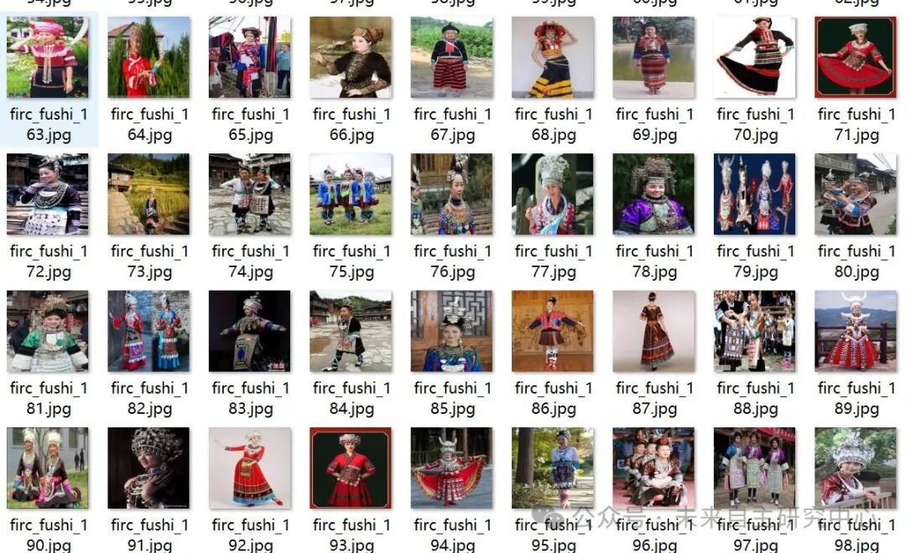
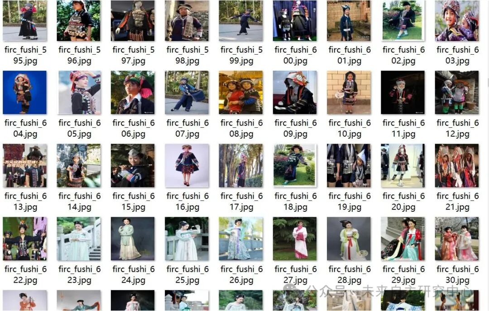
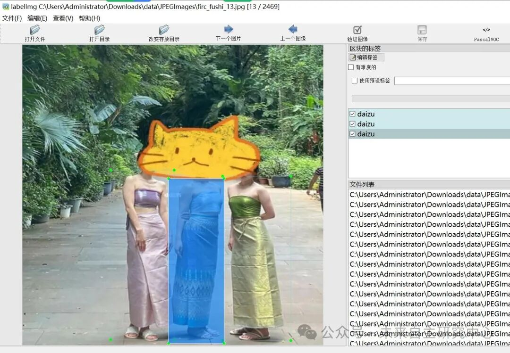

# Chinese Minority Ethnic Clothing Detection Dataset VOC+YOLO format with 2469 images and 55 categories

Dataset format: Pascal VOC format + YOLO format (txt file without split path, only containing jpg images and corresponding VOC format xml files and yolo format txt files)

Number of images (number of jpg files): 2469

Number of annotations (number of xml files): 2469

Number of annotations (number of txt files): 2469

Annotation category count: 55

Label names: ["achangzu", "baizu", "baoanzu", "bulangzu", "buyizu", "chaoxianzu", "daizu", "dawoerzu", "deangzu", "dong", "dongxiangzu", "dulongzu", "elunchunzu", "eluosizu", "ewenkezu", "gaoshanzu", "hanizu", "hanzu", "hasakezu", "hezhenzu", "huizu", "jingpozu", "jingzu", "jinuozu", "keerkezizu", "lahuzu", "lizu", "luobazu", "manzu", "maonanzu", "menbazu", "menguzu", "miaozu", "mulaozu", "naxizu", "nuzu", "pumizu", "qiangzu", "salazu", "shezu", "shuizu", "susuzu", "tajikezu", "tataer", "tujiazu", "tuzu", "wazu", "weiwuezu", "wuzibiekezu", "xibozu", "yaozu", "yizu", "yuguzu", "zangzu", "zhuangzu"]

Number of boxes labeled in each category:

Achangzu Frame Count = 61

Baizu Frame Count = 54

Baoanzu Frame Count = 61

Bulangzu Frame Count = 64

Buyizu Frame Count = 53

chaoxianzu frame count = 61

Daizu Frame Count = 92

dawoerzu frame count = 62

Deangzu Frame Count = 58

dong Frames = 73

dongxiangzu frame count = 108

Dulongzu frame count = 83

elunchunzu frame count = 56

eluosizu frame count = 57

Ewenkezu Frames = 198

gaoshanzu frame count = 54

Hanizu Frame Count = 54

Hanzu Frame Count = 53

hasakezu frame count = 76

hezhenzu frame count = 52

Huizu Frame Count = 82

Jingpozu Frame Count = 64

Jingzu Frame Count = 66

Jinuozu Frame Count = 75

Kerkezizu frame count = 73

lahuzu frame count = 53

Lizu box count = 59

Luobazu Frames = 46

Manzu frame count = 55

maonanzu frame count = 20

Menbazu frame count = 55

Menguzu frame count = 69

miaozu box count = 47

Mulaozu Frame Count = 67

Naxizu frame count = 34

nuzu box count = 40

pumizu frame count = 44

qiangzu frame count = 43

salazu box count = 42

shezu frame count = 51

Shuizu Frame Count = 50

Susuzu Frame Count = 43

tajikezu frame count = 42

Tataer Frame Count = 39

Tujiazu Frame Count = 49

Tuzu Frame Count = 44

wazu box count = 46

weiwuezu box count = 42

wuzibiekezu box count = 50

xibozu frame count = 56

Yaozu Frame Count = 60

Yizu frame count = 61

yuguzu frame count = 76

Zangzu frame count = 43

Frame count = 38

Total frame count: 3254

Using labelImg:

Annotation rules: Draw a rectangle around the category.

Important Notice: No

Special : This dataset does not guarantee the accuracy or precision of the trained models or weight files. The dataset is provided with accurate and reasonable annotations only.

Image Preview:

Annotation example:

## Payment

Here is a pay link on Stripe ( https://buy.stripe.com/3cs8yP7sY87d0vu9AB ). Please contact me lonlonago@foxmail.com after funding $89, and I will send you a complete data files , thank you!

